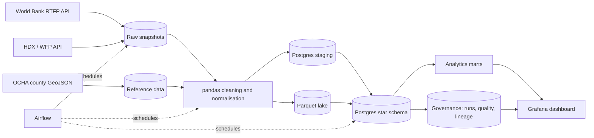

# Kenya Food Price & Inflation Platform

A data platform for tracking food prices in Kenyan markets, detecting inflation
patterns, and producing county-level evidence for consumers, farmers and
policymakers.

**Current milestone:** Milestone 1 — source profiling and architecture. The
pipeline, Airflow DAGs, warehouse loader and dashboard will be added in later
milestones.

## Chosen sources

| Source | Role | Coverage | Licence |
|---|---|---|---|
| [World Bank RTFP Kenya](https://microdata.worldbank.org/catalog/6167) | Primary permitted source: monthly modelled prices and food price index | 2007–2026, 234 markets, 3 commodities | World Bank open data; citation required |
| [WFP Kenya food prices](https://data.humdata.org/dataset/wfp-food-prices-for-kenya) | Supporting observed prices for product breadth and validation | 2006–2026, 226 markets, 51 commodity labels | CC BY-IGO |
| [OCHA COD-AB Kenya](https://data.humdata.org/dataset/cod-ab-ken) | 47-county reference geography | Admin-1 boundaries | CC BY-IGO |

World Bank RTFP is the primary source because it provides a complete monthly
panel and a market-level food price index. WFP supplies observed prices and
broader commodity coverage; it is also useful for checking the modelled RTFP
values. The platform never hides the distinction: RTFP rows will be marked as
modelled, WFP rows as observed.

## Architecture



The full design rationale is in [`docs/architecture.md`](docs/architecture.md).

## Star schema

- **Dimensions:** date, county, market, product, product alias, source, unit.
- **Facts:** `fact_price_observation` at source × market × product × date ×
  price type × native unit; `fact_food_price_index` at source × market × month.
- **Marts (planned):** monthly prices, county inflation, product comparison,
  source agreement and pipeline health.

See [`docs/data_dictionary.md`](docs/data_dictionary.md) for columns and grain.
The M1 DDL is in [`sql/star_schema.sql`](sql/star_schema.sql).

## Repository layout

```text
docs/                  source profile, architecture, data dictionary, decisions
metadata/              source catalogue, product catalogue, county reference
scripts/               reproducible reference-data build
sql/                   star-schema DDL
```

## Milestone 1 evidence

- Source profile: [`docs/source_profile.md`](docs/source_profile.md)
- Architecture: [`docs/architecture.md`](docs/architecture.md)
- Data dictionary: [`docs/data_dictionary.md`](docs/data_dictionary.md)
- Design decisions: [`docs/decisions.md`](docs/decisions.md)
- Milestone submission: [`docs/milestone_1.md`](docs/milestone_1.md)
- Source catalogue: [`metadata/sources.yml`](metadata/sources.yml)
- Star-schema DDL: [`sql/star_schema.sql`](sql/star_schema.sql)

## Known limitations

- World Bank RTFP is modelled, not observed, and covers only beans, maize and
  live goat.
- Only 27 of 47 counties have market observations in the source data. Missing
  counties will be shown as no-data; the platform will not interpolate them.
- The RTFP food price index contains a structural break in 2023–24 that must be
  documented and handled in the analytics layer.
- WFP coverage is sparse and concentrated in arid and semi-arid markets.

## Licence and attribution

Code is released under the MIT licence. Data remains under its publishers'
terms: World Bank RTFP open data with citation, WFP/HDX CC BY-IGO, OCHA COD-AB
CC BY-IGO. See [`metadata/sources.yml`](metadata/sources.yml) for citation text.
