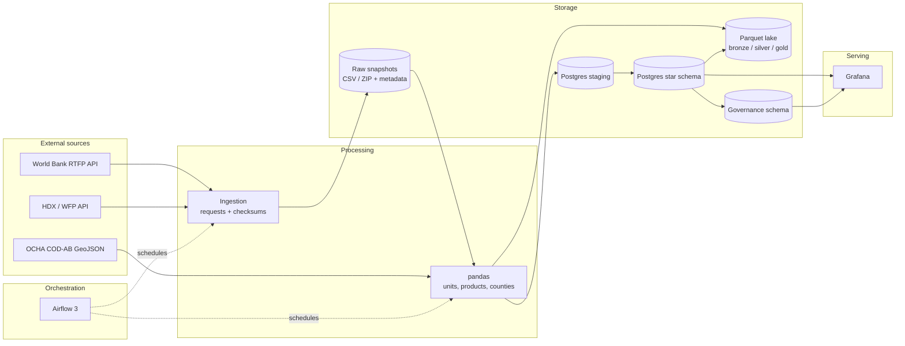
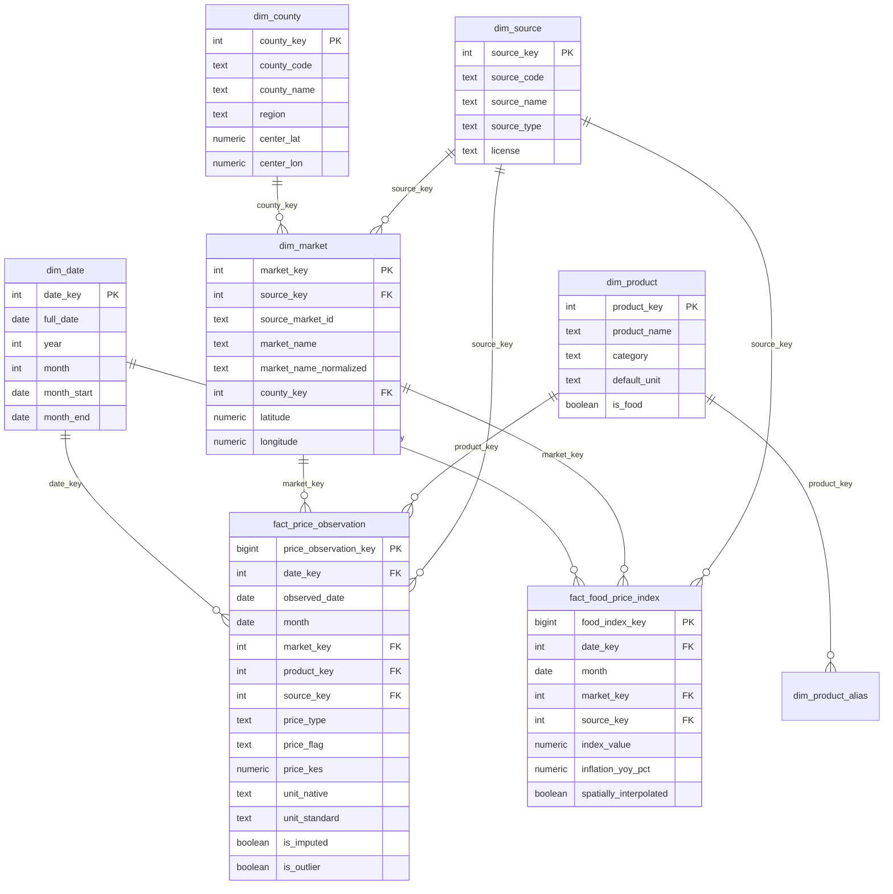

# Architecture

## 1. Design goals

- Ingest public food-price data reproducibly.
- Preserve observed and modelled values as distinct facts.
- Normalise currencies, units, products and geography.
- Serve county-level price and inflation questions from a star schema.
- Make every run, rejection and lineage edge auditable.
- Keep the batch path simple enough to defend end-to-end.

## 2. System context

## 3. Runtime topology

| Component | Planned implementation | Purpose |
|---|---|---|
| Postgres | PostgreSQL 16 | Airflow metadata, warehouse, governance |
| Airflow | Airflow 3, LocalExecutor | Weekly source DAGs and daily warehouse build |
| Processing | Python 3.12 + pandas | Download, clean, normalise, load |
| Lake | Local Parquet (bronze/silver/gold) | Replayable intermediate layers |
| Dashboard | Grafana 11 | Price trends, county inflation, product comparison |
| Reference server | nginx | Serve the 47-county GeoJSON if a map panel is added |

The stack will run with Docker Compose. No cloud service is required.

## 4. Data layers

| Layer | Content | Retention |
|---|---|---|
| Raw | Downloaded CSV/ZIP + metadata JSON + SHA-256 | Last 12 versions |
| Bronze | Parsed source-shaped Parquet | Latest version |
| Silver | Cleaned, typed, normalised Parquet | Latest version |
| Gold | Exported marts | Latest version |
| Warehouse | Dimensions, facts, marts | Full history |
| Rejected | Rows failing critical validation + reason | Latest version |

Raw files are immutable. The pipeline never edits a downloaded file; it writes a
new silver/gold file from it.

## 5. Star schema

### Grain decisions

- `fact_price_observation` is one row per **source × market × product × observed
  date × price type × native unit**. The native unit is in the key so `KG` and
  `90 KG` observations on the same day are preserved; `price_kes` standardises
  them to kg/L/unit.
- `fact_food_price_index` is one row per **source × market × month**. The index is
  not a price in KES and must not be mixed into the price fact.

## 6. Planned marts

| Mart | Grain | Questions |
|---|---|---|
| `mart_price_monthly` | month × county × market × product | What is the median price? |
| `mart_commodity_monthly` | month × product | How have prices changed over time? |
| `mart_county_inflation` | month × county | Which counties have the highest inflation? |
| `mart_product_county_latest` | product × county at latest covered month | Where is this product cheapest/most expensive? |
| `mart_source_agreement` | month × product × market | Do observed and modelled prices agree? |
| `mart_pipeline_health` | source | Is the pipeline fresh and passing checks? |

## 7. Planned orchestration

| DAG | Schedule | Responsibility |
|---|---|---|
| `wfp_kenya_ingest` | Weekly | HDX discovery, download, checksum, silver |
| `wb_rtfp_ingest` | Weekly | RTFP version discovery, download, checksum, silver |
| `build_food_price_warehouse` | Daily | Upsert dimensions/facts, refresh marts, quality checks |
| `kenya_food_prices_pipeline` | Manual | End-to-end backfill/demo |

Idempotency is enforced through natural-key upserts. Critical quality failures
fail the DAG; warnings are recorded and shown in the dashboard.

## 8. Design principles

1. **Observed vs modelled is explicit.** RTFP is modelled; WFP is observed.
2. **No silent interpolation.** Missing counties remain missing.
3. **Native and standard units are both stored.**
4. **Raw data is immutable and checksummed.**
5. **Every fact row carries a `run_id`.**
6. **Quality results are persisted, not just logged.**
7. **The dashboard reads marts, not raw facts.**
8. **Streaming is optional and comes after the batch path is reproducible.**

## 9. Out of scope for Milestone 1

- Source downloaders and cleaning code (Milestone 2–3).
- Airflow DAG implementation (Milestone 5).
- Dashboard implementation (Milestone 7).
- Kafka/Spark streaming (optional extension).

Milestone 1 delivers the source profile, architecture, star schema and design
decisions that the later milestones implement.
