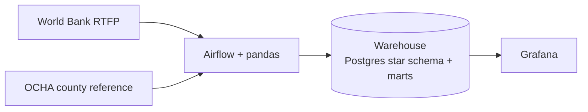

# Architecture

The platform is a batch pipeline. Airflow schedules the work, Python/pandas
cleans and normalises the data, and a PostgreSQL warehouse stores the star
schema and marts for Grafana.

## Star schema

Dimensions: date, county, market, product, source, unit.

- `fact_price_observation`: one row per source × market × product × date ×
  price type × native unit.
- `fact_food_price_index`: one row per source × market × month.

## Notes

- World Bank RTFP is the primary source; its prices are modelled.
- Missing counties are not interpolated.
- WFP can be added later as a supporting observed-price source.
- DDL: [`sql/star_schema.sql`](../sql/star_schema.sql).
